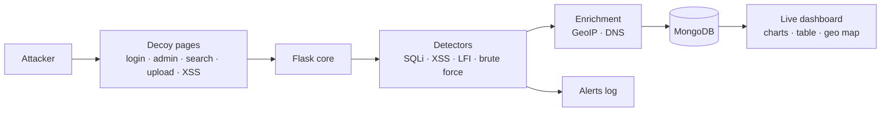

<div align="center">

# 🍯 Honeypot-in-a-Box: Intelligent Web Honeypot

**A deployable web honeypot that exposes decoy vulnerable pages, detects SQLi, XSS, LFI and brute-force attacks, enriches them with GeoIP, and shows attackers on a live dashboard.**


</div>

> 📌 Modular rewrite of the honeypot idea. The ML-classification version with a full threat dashboard is **[Honeypot-in-a-Box-Computer-Security](https://github.com/Ghanasree-S/Honeypot-in-a-Box-Computer-Security)**.

> ⚠️ **For education and authorised research only.** Deploy only on infrastructure you own.

---

## 🎯 How It Works



1. **Decoy surface**: a realistic React frontend with fake login, admin panel, search, file upload and an XSS-prone page.
2. **Detection**: each request goes through pattern-based detectors in `detectors/` (`sql_injection.py`, `xss.py`, `lfi.py`, `brute_force.py`).
3. **Enrichment**: attacker IPs are geolocated (`utils/geoip.py`) and annotated (`utils/enrich.py`).
4. **Storage and alerting**: events are stored in MongoDB, and high-severity hits are written to `alerts.log`.
5. **Visualisation**: the dashboard shows attack stats, a timeline chart, an event table and a geo map.

## ✨ Features

- 🎭 Multiple decoy endpoints that look like a real vulnerable site
- 🔍 Regex detectors for **SQL injection, XSS, local file inclusion and brute-force** attempts
- 🌍 GeoIP and DNS enrichment of attacker sources
- 📊 Dashboard components: `StatCard`, `AttackChart`, `AttackTable`, `GeoMap`
- 🧪 `tests/attack_simulator.py` to generate realistic attack traffic, plus unit tests
- 🐳 Docker, docker-compose and nginx configs for deployment
- 📄 SRS and workflow docs in `docs/`

## 🛠️ Tech Stack

| Layer | Tools |
|---|---|
| Backend | Flask, Flask-CORS, PyMongo, geoip2, dnspython |
| Frontend | React, Vite, Tailwind CSS |
| Database | MongoDB |
| Deploy | Docker, docker-compose, nginx |

## 📁 Structure

```
├── app.py                 # entry point (HONEYPOT_HOST / HONEYPOT_PORT / HONEYPOT_DEBUG)
├── core/routes/           # admin, api, login, xss decoy routes
├── detectors/             # sqli, xss, lfi, brute-force detectors
├── database/              # Mongo models and connection
├── utils/                 # geoip, enrichment, alerts, logging
├── dashboard/             # dashboard app
├── frontend/              # React decoy site and dashboard
├── deployment/            # Dockerfile, docker-compose, nginx
├── tests/                 # attack simulator and unit tests
└── docs/                  # SRS and workflow
```

## 🚀 Run Locally

```bash
pip install -r requirements.txt
export MONGO_URI="mongodb://localhost:27017/intelligent_honeypot"
python app.py                      # backend on :5000

cd frontend && npm install && npm run dev

python tests/attack_simulator.py   # send simulated attacks
```

**Docker**
```bash
cd deployment
docker-compose up --build
```

## 👩‍💻 Author

**Ghanasree S**: [GitHub](https://github.com/Ghanasree-S) · [LinkedIn](https://www.linkedin.com/in/ghanasree-s-88976b2b0)
